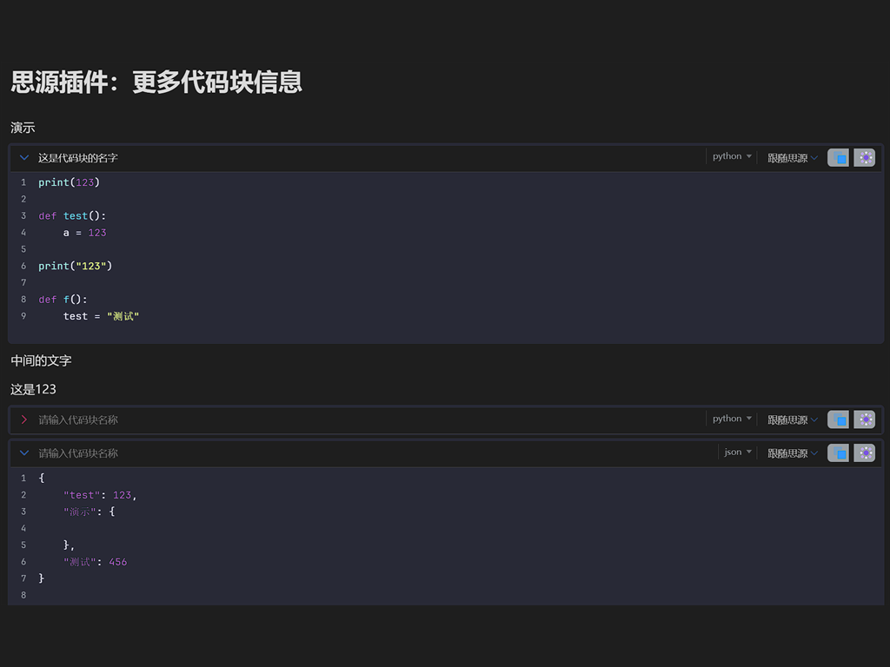

# SiYuan More Code Block Info

A [SiYuan](https://b3log.org/siyuan) plugin that turns the code block header into a compact information bar: name, language, highlight theme and collapse.



## Features

| Feature | Description |
| --- | --- |
| **Code block name** | Type a name in the header (up to 20 characters). The name is saved when the input loses focus and stored in the block attribute `custom-code-block-name`, so it stays with the block on every device. |
| **Language** | The native language label is kept and moved to the right side of the header. Clicking it still opens SiYuan's language menu. |
| **Highlight theme** | Pick a theme per code block from the header menu. A global default can be set in the plugin settings. "Follow SiYuan" keeps the native appearance. |
| **Collapse whole block** | Click the arrow on the left of the header to hide the code and keep only the header. The state is stored in `custom-code-block-fold`. |
| **Native copy / more** | The original copy and more buttons are preserved and keep their native behavior. |
| **Light / dark friendly** | The header follows the current SiYuan theme. |

## Install

### From the community bazaar (recommended)

1. Open **Settings → Bazaar → Plugins** in SiYuan.
2. Search for **Code Block More Info**.
3. Install and enable the plugin.

### Manually

1. Download `package.zip` from the latest GitHub Release.
2. Extract it to `<workspace>/data/plugins/siyuan-more-code-block-info/`.
3. Restart SiYuan, then enable the plugin in **Settings → Bazaar → Downloaded**.

## Usage

1. Create or open any code block.
2. Click the placeholder **Enter code block name** on the left of the header and type a name. The name is saved when you click elsewhere.
3. Use the theme menu on the right to override the highlight theme for this block.
4. Click the arrow on the far left to collapse or expand the whole block.

## Settings

**Settings → Bazaar → Plugins → Code Block More Info → Settings**

- **Default code highlight theme**: used by code blocks that have no per-block theme. Choose **Follow SiYuan** to keep the native highlight style.

## Compatibility

- SiYuan **3.8.5** or newer.
- Desktop, mobile and browser frontends.
- No network requests, no kernel script and no background service. Block attributes are stored in your documents and synced by SiYuan itself.

## FAQ

**The header does not change after installation.**
Make sure the plugin is enabled, then reload the document or restart SiYuan. The plugin only decorates `.code-block` elements that are rendered in the editor.

**The theme does not apply to a block.**
A per-block theme always wins over the global default. Set the block theme to **Follow default** to use the global value, or to **Follow SiYuan** to keep the native style.

**Does the name survive sync?**
Yes. The name and collapse state are stored as block attributes, which are part of the document data.

**Will it work in published / shared documents?**
The plugin is declared with `disabledInPublish: true`, so it does not run in published pages.

## Development

```bash
scripts/install.sh      # install dependencies
scripts/dev.sh          # watch build into dev/
scripts/build.sh        # build dist/ and package.zip
```

Windows PowerShell equivalents live in the same `scripts/` folder. See [docs/开发文档.md](docs/开发文档.md) for the architecture and [docs/发布指南.md](docs/发布指南.md) for the complete bazaar release process.

## Changelog

See [docs/更新日志.md](docs/更新日志.md).

## License

MIT


