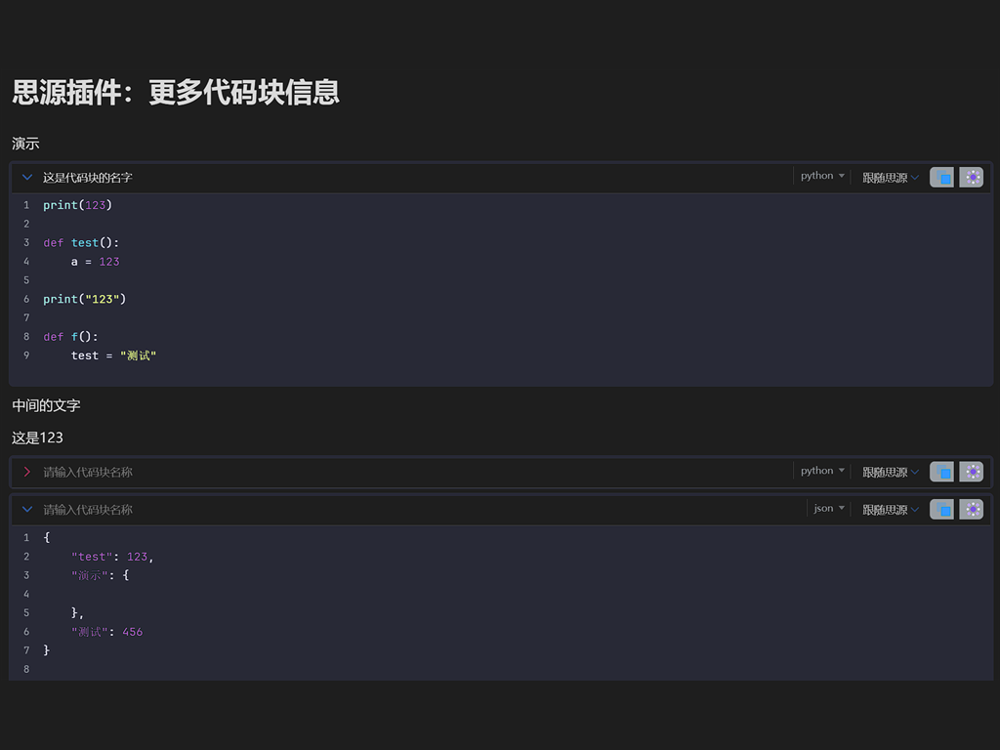

# 思源插件：代码块更多信息

把思源笔记代码块的标题栏变成一个紧凑的信息条：名称、语言、高亮主题与整块收起。



## 功能

| 能力 | 说明 |
| --- | --- |
| **代码块名称** | 在标题栏左侧输入名称（最多 20 个字符），输入框失焦后自动保存，写入块属性 `custom-code-block-name`，随文档同步。 |
| **语言** | 保留思源原生语言标签并移动到标题栏右侧，点击后仍使用思源自带的语言菜单切换。 |
| **高亮主题** | 通过标题栏右侧的主题菜单为单个代码块选择高亮主题；也可在插件设置中配置全局默认主题。「跟随思源」保持原生外观。 |
| **整块收起** | 点击标题栏最左侧的箭头，只保留标题栏、隐藏代码内容；状态写入块属性 `custom-code-block-fold`。 |
| **原生复制 / 更多** | 保留思源原有按钮，行为不变。 |
| **明暗主题适配** | 标题栏跟随当前思源主题。 |

## 安装

### 从社区集市安装（推荐）

1. 在思源中打开 **设置 → 集市 → 插件**。
2. 搜索 **代码块更多信息**。
3. 点击安装并启用。

### 手动安装

1. 从 GitHub Release 下载最新版本的 `package.zip`。
2. 解压到 `<工作空间>/data/plugins/siyuan-more-code-block-info/`。
3. 重启思源，在 **设置 → 集市 → 已下载** 中启用插件。

## 使用

1. 新建或打开任意代码块。
2. 点击标题栏左侧的「请输入代码块名称」并输入名称，点击其他位置后自动保存。
3. 在标题栏右侧的主题菜单中选择该代码块的高亮主题。
4. 点击最左侧的箭头，收起或展开整块代码。

## 设置

**设置 → 集市 → 插件 → 代码块更多信息 → 设置**

- **默认代码高亮主题**：未单独设置主题的代码块使用该主题。选择「跟随思源」则保持思源原生高亮样式。

## 兼容性

- 思源笔记 **3.8.5** 及以上版本。
- 桌面端、移动端与浏览器端均可使用。
- 插件不发起网络请求，不包含内核脚本，也没有后台服务。名称、主题与收起状态以块属性形式保存在文档中，由思源自身负责同步。

## 常见问题

**安装后标题栏没有变化？**
请确认插件已启用，然后重新打开文档或重启思源。插件只会处理编辑器中已经渲染的 `.code-block` 元素。

**主题没有生效？**
单块主题的优先级高于全局默认主题。把该块的主题改为「跟随默认」即可使用全局设置，改为「跟随思源」则保持原生样式。

**名称会随同步保留吗？**
会。名称与收起状态都写入块属性，属于文档数据的一部分。

**发布（分享）页面中会生效吗？**
插件声明了 `disabledInPublish: true`，在发布页面中不会运行。

## 开发

```bash
scripts/install.sh      # 安装依赖
scripts/dev.sh          # 监听构建，输出到 dev/
scripts/build.sh        # 构建 dist/ 与 package.zip
```

Windows PowerShell 版本脚本位于同一 `scripts/` 目录。架构说明见 [docs/开发文档.md](docs/开发文档.md)，完整的上架流程见 [docs/发布指南.md](docs/发布指南.md)。

## 更新日志

见 [docs/更新日志.md](docs/更新日志.md)。

## 许可证

MIT

