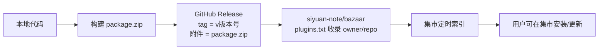

# 发布指南：上架思源社区集市

本文档说明如何把「代码块更多信息」插件发布到思源社区集市，包含发布前检查、构建、创建 Release、提交集市 PR、后续版本更新与常见失败原因。

- 项目仓库：<https://github.com/Coshining/Siyuan-more-code-block-info>
- 集市索引仓库：<https://github.com/siyuan-note/bazaar>
- 集市提交规则：<https://github.com/siyuan-note/bazaar#submitting-a-bazaar-package>
- 集市校验源码：<https://github.com/siyuan-note/bazaar/tree/main/rules>

---

## 1. 发布模型

思源集市不接收直接上传的插件包，它只读取 **GitHub Release**：



两个前提缺一不可：

1. 仓库有 **Latest Release**，且该 Release 附带名为 `package.zip` 的二进制附件；
2. 仓库已写入 `siyuan-note/bazaar` 的 `plugins.txt`（仅首次上架需要提交 PR）。

后续更新只需发布新的 Release 并提升 `plugin.json` 的 `version`，无需再次提交 PR。

---

## 2. 集市硬性规则

下表是本项目发布时必须满足的规则，均来自集市 `rules/` 校验逻辑。

| 类别 | 规则 | 本项目当前状态 |
| --- | --- | --- |
| 包根必要文件 | `package.zip` 根目录必须存在 `README.md`、`plugin.json`、`index.js` | ✅ 已包含 |
| 图标 | `icon.png`，支持 PNG/JPEG/WebP/AVIF（不支持 SVG），**≤ 64 KB**，建议 160×160 | ✅ 160×160，约 27 KB |
| 预览图 | `preview.png`，支持 PNG/JPEG/WebP/AVIF（不支持 SVG），**≤ 512 KB**，建议 1024×768 | ✅ 1024×768，约 77 KB |
| `name` | 必填，可打印 ASCII，全局唯一（不区分大小写），建议与仓库名一致 | ✅ `siyuan-more-code-block-info` |
| `author` | 必填，非空字符串 | ✅ `Co-shining` |
| `url` | 必填，必须为 `https://github.com/<owner>/<repo>`，不能带 `.git` 或末尾斜杠 | ✅ `https://github.com/Coshining/Siyuan-more-code-block-info` |
| `version` | 必填，合法语义化版本，**不能带 `v` 前缀**；更新时必须高于已上架版本 | ✅ `0.1.5` |
| `readme` | 必填对象，必须包含 `default` 键，值是包根相对路径且文件真实存在（大小写敏感） | ✅ `README.md` / `README.zh-CN.md` |
| `displayName` / `description` | 若填写必须是「语言 → 字符串」对象 | ✅ 含 `default` 与 `zh-CN` |
| `backends` / `frontends` / `kernels` | 字符串数组；**包含 `all` 时不能再混入其他值** | ✅ 均为 `["all"]` |
| `funding` | 可省略；若填写，`custom` 中不能出现模板占位链接 | ✅ 已删除空 `funding` |
| 包内路径 | 正斜杠 `/` 分隔、大小写敏感；文件名不能以空格开头/结尾，不能是 Windows 保留设备名 | ✅ 构建脚本已强制正斜杠 |
| 不可打包内容 | 包内不能出现以 `.` 开头的条目（如 `.git`、`.github`、`.gitignore`）和 `*.tmp`，也不要把 `node_modules`、日志打进 `package.zip` | ✅ 仅打包 `dist/` |

> 注意：集市索引文件是 **`plugins.txt`**（历史文档中的 `plugins.json` 已废弃），每行一个 `owner/repo`。

---

## 3. 本项目发布配置

`plugin.json` 关键字段：

```json
{
    "name": "siyuan-more-code-block-info",
    "author": "Co-shining",
    "url": "https://github.com/Coshining/Siyuan-more-code-block-info",
    "version": "0.1.5",
    "minAppVersion": "3.8.5",
    "backends": ["all"],
    "frontends": ["all"],
    "kernels": ["all"],
    "displayName": {
        "default": "Code Block More Info",
        "zh-CN": "代码块更多信息"
    },
    "description": {
        "default": "Enrich the code block header with a name, highlight theme and folding.",
        "zh-CN": "为代码块标题栏增加名称、高亮主题与折叠功能。"
    },
    "readme": {
        "default": "README.md",
        "zh-CN": "README.zh-CN.md"
    },
    "icon": "icon.png",
    "preview": "preview.png"
}
```

`package.zip` 的最终结构：

```text
package.zip
├── README.md
├── README.zh-CN.md
├── icon.png          # 160×160，≤64 KB
├── index.css
├── index.js
├── i18n/
│   ├── en_US.json
│   └── zh_CN.json
├── plugin.json
└── preview.png       # 1024×768，≤512 KB
```

---

## 4. 发布前检查清单

每次发布前逐项确认：

- [ ] `plugin.json` 的 `version` 已提升，且比集市已上架版本高
- [ ] `package.json` 的 `version` 与 `plugin.json` 保持一致
- [ ] `name`、`author`、`url` 未被改动（`url` 必须与仓库地址完全对应）
- [ ] `backends` / `frontends` / `kernels` 没有出现 `all` 与其他值混用
- [ ] `icon.png` 为 160×160 且不超过 64 KB
- [ ] `preview.png` 为 1024×768 且不超过 512 KB
- [ ] `README.md`、`README.zh-CN.md` 已更新功能说明
- [ ] `npm run typecheck` 无错误
- [ ] `scripts/build.ps1`（或 `scripts/build.sh`）构建成功
- [ ] `package.zip` 根目录包含第 3 节列出的全部文件
- [ ] 本地安装 `dist/` 后功能正常

### 检查图片体积

```powershell
Get-ChildItem icon.png, preview.png | Select-Object Name, Length
```

```bash
ls -l icon.png preview.png
```

如果图片超限，需要重新导出压缩后的图片（保持 160×160 / 1024×768），再重新构建。注意图片必须是 PNG/JPEG/WebP/AVIF，且扩展名与实际格式一致。

### 检查 zip 结构

```powershell
Add-Type -AssemblyName System.IO.Compression.FileSystem
$zip = [System.IO.Compression.ZipFile]::OpenRead((Resolve-Path 'package.zip'))
$zip.Entries | Select-Object FullName, Length
$zip.Dispose()
```

```bash
unzip -l package.zip
```

---

## 5. 版本号规则

使用语义化版本 `MAJOR.MINOR.PATCH`：

| 场景 | 建议 |
| --- | --- |
| 修复 bug、样式问题 | `PATCH` +1，例如 `0.1.5` → `0.1.6` |
| 新增向后兼容的功能 | `MINOR` +1，例如 `0.1.5` → `0.2.0` |
| 不兼容的配置或数据处理变更 | `MAJOR` +1 |

注意：

- `plugin.json` 与 `package.json` 的 `version` 必须同步修改；
- Git tag 建议写成 `v` + 版本号（如 `v0.1.5`），但 `plugin.json` 中的 `version` **不能**带 `v`；
- 集市只有在检测到 `version` 变化后才会拉取新版本。

---

## 6. 构建

项目要求使用 `scripts/` 下的脚本，不要直接调用 `npm run build`。

Windows PowerShell：

```powershell
.\scripts\build.ps1
```

Linux / macOS / WSL / GitHub Actions：

```bash
bash scripts/build.sh
```

构建会完成：

1. `npm run clean` 清理 `dist/` 与 `package.zip`；
2. `npm run build` 用 Vite 生成 `dist/index.js`、`dist/index.css`；
3. 复制 `plugin.json`、`icon.png`、`preview.png`、`README*.md`、`i18n/` 到 `dist/`；
4. 打包为根目录下的 `package.zip`（Windows 脚本使用 .NET `ZipArchive` 强制写入正斜杠，避免 `invalid marketplace package path`）。

---

## 7. 创建 GitHub Release

### 方式一：GitHub 网页

1. 打开 <https://github.com/Coshining/Siyuan-more-code-block-info/releases/new>。
2. **Choose a tag** 输入 `v0.1.5`，选择 *Create new tag on publish*。
3. Release title 填写 `v0.1.5`。
4. 在描述中粘贴第 10 节的 Release Notes。
5. 上传根目录生成的 `package.zip` 作为附件。
6. 确认 **Set as the latest release**，点击 **Publish release**。

### 方式二：命令行

```bash
git tag v0.1.5
git push origin v0.1.5
```

推送 tag 后，仓库中的 `.github/workflows/release.yml` 会自动构建并创建 Release、上传 `package.zip`（见第 9 节）。也可以使用 GitHub CLI：

```bash
gh release create v0.1.5 package.zip --title "v0.1.5" --generate-notes
```

> 附件名称必须是 `package.zip`，不要改名。由 Actions 创建的 Release 默认使用自动生成的提交说明，发布后可以再编辑为第 10 节的功能说明。

---

## 8. 首次上架集市（只需一次）

### 8.1 前置条件

- 仓库已有包含 `package.zip` 的 Latest Release；
- 提交者必须是插件作者，或已获得作者授权；
- 仓库许可证允许再分发（本项目为 MIT）。

### 8.2 提交 PR

1. Fork <https://github.com/siyuan-note/bazaar>，如已 Fork 请先同步最新 `main`。
2. 编辑根目录的 `plugins.txt`，**新增一行**：

   ```text
   Coshining/Siyuan-more-code-block-info
   ```

3. 只做这一处改动，不要删除或修改其他行，也不要在同一个 PR 中混入其他包。
4. 提交并创建 Pull Request 到 `siyuan-note/bazaar` 的 `main` 分支，按仓库 PR 模板填写，说明自己是作者并授权集市展示元数据、文档与缓存分发 `package.zip`。
5. 等待 PR Check 自动校验。若失败，按检查评论修改本仓库的 Release 或 `package.zip`，不需要关闭 PR 重开。
6. 审核通过并合并后，集市索引会在几分钟到数小时内更新；重启一次思源以刷新集市缓存。

### 8.3 校验内容

PR Check 会检查第 2 节的规则，包括：Release 是否存在、`package.zip` 是否可下载、必要文件、清单字段、图片体积、路径规范、版本号是否高于已上架版本等。

---

## 9. 自动化发布

仓库包含 `.github/workflows/release.yml`，触发条件为推送 `v*` 标签：

1. 校验 tag 与 `plugin.json` 的 `version` 是否一致；
2. `npm ci` 安装依赖；
3. `npm run typecheck`；
4. `bash scripts/build.sh` 生成 `package.zip`；
5. 创建 GitHub Release 并上传 `package.zip`。

因此日常发布流程可以简化为：

```bash
# 1. 修改代码与 plugin.json / package.json 的 version
# 2. 本地验证
.\scripts\build.ps1
# 3. 提交代码
git add -A
git commit -m "chore: release v0.1.6"
git push
# 4. 打标签触发自动发布
git tag v0.1.6
git push origin v0.1.6
```

如果 Actions 无法创建 Release，检查仓库 **Settings → Actions → General → Workflow permissions** 是否允许 *Read and write permissions*。

---

## 10. Release Notes 模板

首次发布（v0.1.5）可直接使用：

```markdown
## 代码块更多信息 v0.1.5

首个公开版本。

### 功能

- 代码块名称：标题栏内直接输入，最多 20 个字符，保存到块属性并随文档同步
- 语言：保留原生语言标签，可点击切换
- 高亮主题：每个代码块可独立选择，设置中可配置全局默认主题
- 整块收起：只保留标题栏，状态持久化
- 保留思源原生复制 / 更多按钮

### 兼容性

- 思源笔记 3.8.5 及以上
- 桌面端、移动端、浏览器端

### 安装

在思源「设置 → 集市 → 插件」中搜索「代码块更多信息」并安装，或手动解压 `package.zip` 到 `data/plugins/siyuan-more-code-block-info/`。

**完整更新日志**：`CHANGELOG` 见仓库 `docs/更新日志.md`。
```

英文摘要：

```markdown
The first public release of Code Block More Info.

- Name your code blocks directly in the header (up to 20 characters, synced as a block attribute)
- Keep the native language label and switch languages as before
- Choose a highlight theme per block, with a global default in settings
- Collapse the whole block and keep only its header
- Native copy / more buttons are preserved

Requires SiYuan 3.8.5+.
```

---

## 11. 常见失败原因

| PR Check 报错关键词 | 原因 | 处理 |
| --- | --- | --- |
| `version` 不高于已上架版本 | 忘记提升版本号 | 修改 `plugin.json` 与 `package.json`，重新发布 Release |
| `url` 当前为 ... | 仓库地址大小写/用户名不一致 | 改成 `https://github.com/Coshining/Siyuan-more-code-block-info` |
| 图标超过上限 64 KB | 图片未压缩 | 重新导出 160×160、≤64 KB 的 PNG |
| 预览图超过上限 512 KB | 图片未压缩 | 重新导出 1024×768、≤512 KB 的图片 |
| `all` 与其他值混用 | `backends` / `frontends` / `kernels` 同时写了具体平台和 `all` | 只保留 `["all"]` |
| 缺少必要文件 `README.md` / `index.js` | 打包目录不对 | 用 `scripts/build.ps1` / `build.sh` 重新构建 |
| `readme.zh-CN` 找不到文件 | 路径大小写不一致或未打进包 | 确认 `README.zh-CN.md` 在包根 |
| `invalid marketplace package path` | zip 条目使用反斜杠 | 使用仓库脚本打包，不要用资源管理器右键压缩 |
| 集市长时间未更新 | Release 不是 Latest，或版本号未变化 | 检查 Release 状态与 `version` |

---

## 12. 相关链接

- 插件开发入门：<https://siyuan-note.apifox.cn/7069547m0>
- 插件样例（官方）：<https://github.com/siyuan-note/plugin-sample>
- 插件样例（Vite + Svelte）：<https://github.com/siyuan-note/plugin-sample-vite-svelte>
- 集市仓库：<https://github.com/siyuan-note/bazaar>
- 集市索引状态：<https://github.com/siyuan-note/bazaar/actions>
- 思源后端 API：<https://github.com/siyuan-note/siyuan/blob/master/API_zh_CN.md>
